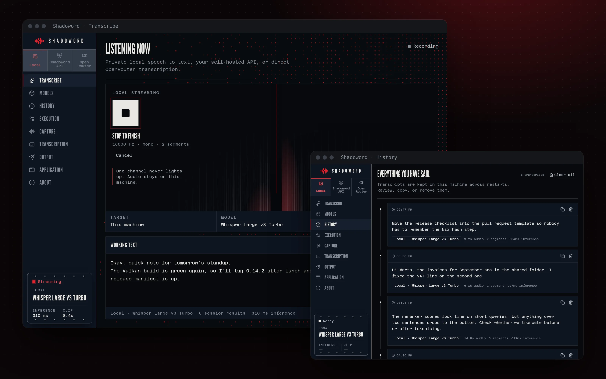
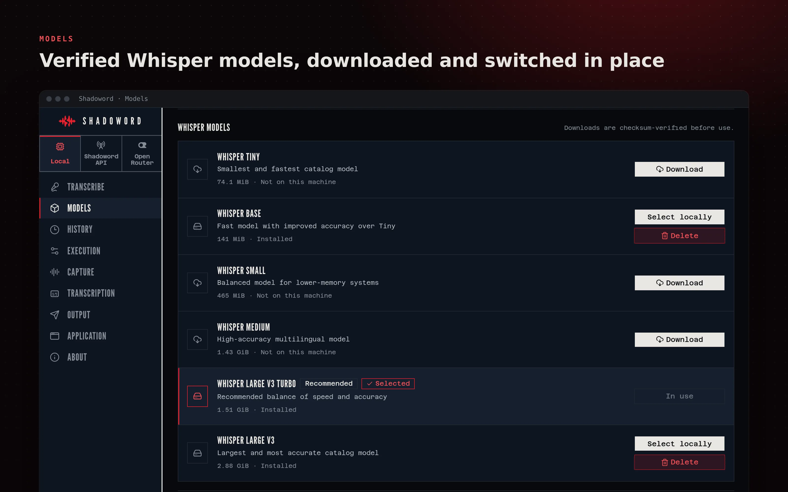
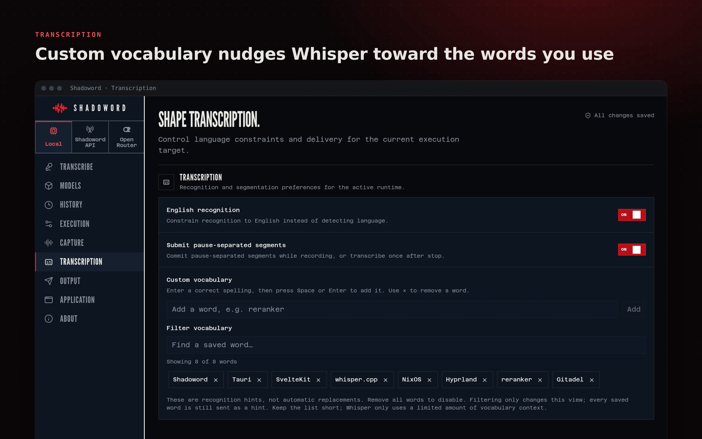
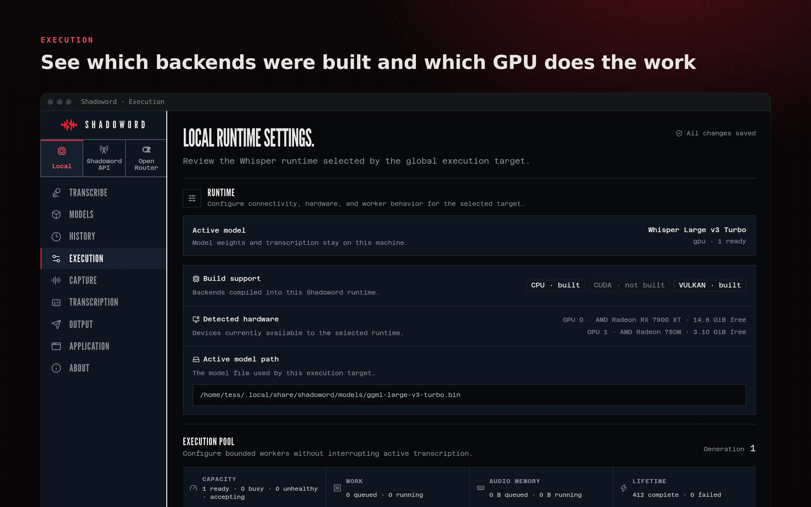

<p align="center">
  
</p>

<p align="center">
  <a href="https://github.com/Fractal-Tess/shadoword/releases"></a>
  <a href="https://github.com/Fractal-Tess/shadoword/actions/workflows/ci.yml"></a>
  <a href="LICENSE"></a>
</p>

<h1 align="center">Shadoword</h1>

<p align="center">
  
</p>

<p align="center">
  Private speech-to-text for Linux. Hold a shortcut, speak, and the text lands in whatever app has focus.
</p>

Most dictation tools send your voice to someone else's server. Shadoword runs Whisper on your own machine by default, on the CPU or a CUDA or Vulkan GPU. If your laptop is too slow for that, point it at a Shadoword daemon on a bigger box you own. It is a Tauri 2 desktop app; audio capture, inference, hotkeys, the tray, and typing the result all happen in Rust, so the webview never touches your microphone or credentials.

- **Dictate** anywhere with a global push-to-talk or toggle shortcut. Text is typed directly, pasted, or copied to the clipboard.
- **Choose** where inference runs: local Whisper, a self-hosted Shadoword API daemon, or OpenRouter when you want a hosted model.
- **Stream** long dictation in pause-separated segments, and steer spelling with a custom vocabulary list.

## Quick start

Download the desktop archive for your hardware from [Releases](https://github.com/Fractal-Tess/shadoword/releases): `shadoword-desktop-x86_64-linux.tar.gz` for CPU, or the `-cuda` or `-vulkan` variant for GPU inference. On Nix:

```bash
nix run github:Fractal-Tess/shadoword#shadoword-desktop
```

Open **Models**, download Whisper Large v3 Turbo (the recommended model, 1.5 GiB), then hold **F2** and talk. Release the key and the transcript is typed into the focused window. Change the shortcut under **Capture**.

To run inference on another machine, start the daemon there and connect the desktop to it under **Execution**:

```bash
shadoword-api token generate admin "desktop administrator"
shadoword-api --download-model turbo
```

[INSTALL.md](INSTALL.md) covers the NixOS and Home Manager modules, Docker images, and the daemon's tokens and endpoints.

## A closer look

<table>
  <tr>
    <td></td>
    <td></td>
  </tr>
  <tr>
    <td colspan="2"></td>
  </tr>
</table>

## Custom vocabulary

Under **Transcription → Custom vocabulary**, type a word such as `reranker` and press Space or Enter to add it. Whisper gets the list as its initial prompt, so it nudges spelling rather than replacing words. Keep it short. In Shadoword API mode the list is stored on the daemon and applies to all its clients.

## More

- [INSTALL.md](INSTALL.md): release archives, Nix, NixOS and Home Manager modules, Docker, and the Shadoword API.
- [CONTRIBUTING.md](CONTRIBUTING.md): development setup, checks, workspace layout, and how the README images are made.
- [CHANGELOG.md](CHANGELOG.md): release history.

Shadoword is released under the [MIT license](LICENSE).
